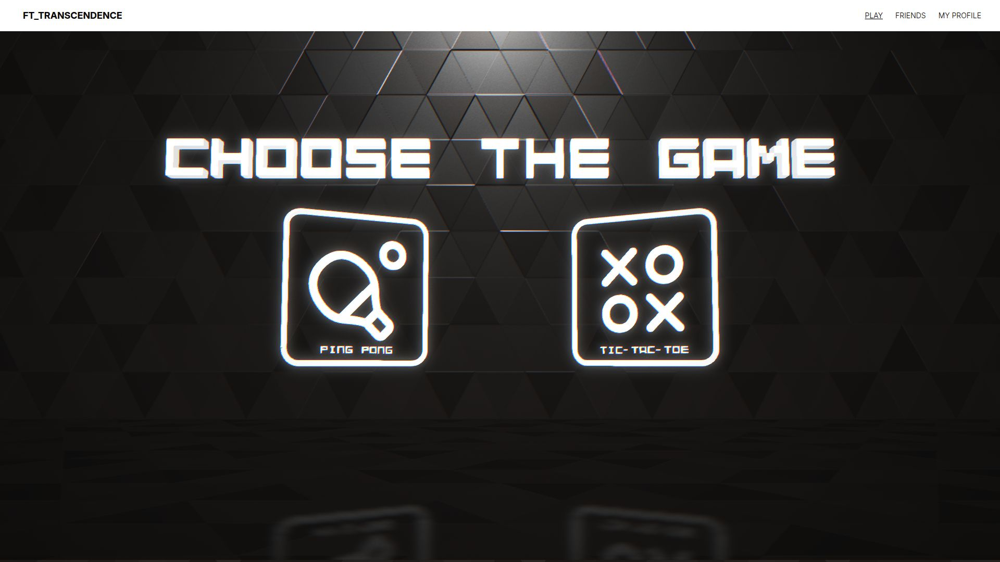
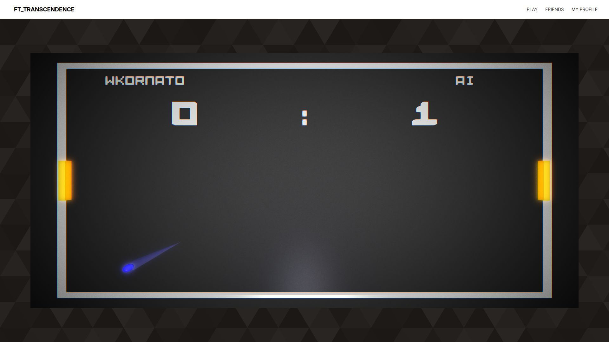
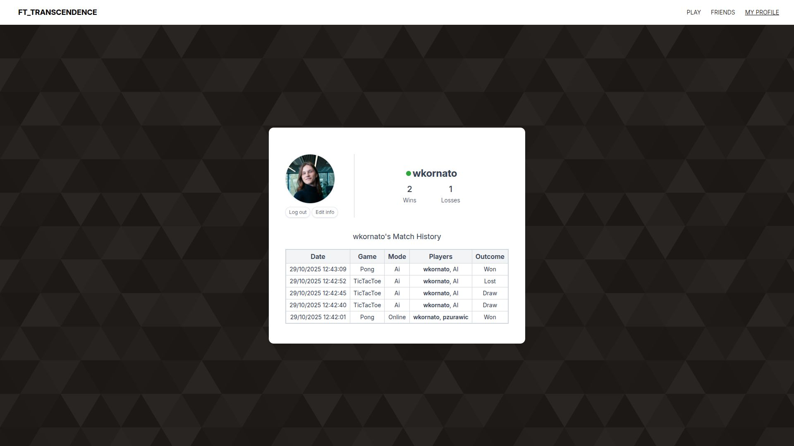

# ft_transcendence



**ft_transcendence** is a web-based gaming platform built to play **Ping Pong** and **Tic Tac Toe** locally, online, in tournaments, or against an **AI opponent**. It includes profiles, avatars, friends, match history, score tracking, and amazing graphics! This is the final project in our Common Core journey through 42 Warsaw.

 

## Features

* Real-time games: Ping Pong (3D) and Tic Tac Toe
* Local play, online matches, tournaments, and AI opponents
* User profiles with avatars
* Friends, scores, and match history
* Minimalistic UI with 3D graphics
* Focuses on security and the ease of diagnosing errors

## Tech Stack

* **Languages:** TypeScript, JavaScript
* **Backend:** Fastify
* **Frontend:** Tailwind CSS
* **3D / Graphics:** Babylon.js
* **Database:** SQLite
* **Tooling:** Docker, Docker Compose, npm, ELK Stack

## Getting Started

Minimum setup from a fresh clone.

Before starting, copy and fill the provided environment templates:

* `.env.example` → `.env`

Then start the application:

```bash
docker compose up app
```

Once running, open:

```
https://localhost:3000
```

You should see the application homepage.

## Authors

* **Wojtek Kornatowski** - [xwojtuss](https://github.com/xwojtuss)
* **Patryk Żurawicki** - [Zuraw7](https://github.com/Zuraw7)
* **Maria Dokukina** - [MDS-42](https://github.com/MDS-42)
* **Damian Majchrowski** - [aiadict](https://github.com/aiadict)

